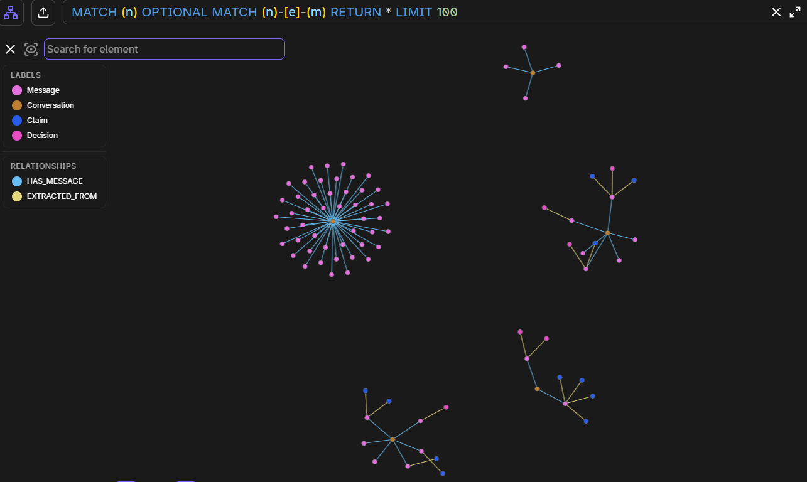

# Ledger

A local **decision-memory graph** over your AI chats. Exports become conversations and messages in [FalkorDB](https://www.falkordb.com/), then an LLM extracts entities, claims, and decisions with provenance back to the source message.

You query it from the CLI or from Cursor / Claude Desktop over **stdio MCP**.



A real graph after ingest + extract: orange **Conversation** hubs, pink **Message** stars (`HAS_MESSAGE`), and claims/decisions hanging off messages (`EXTRACTED_FROM`). Islands are normal — chats only join when they share an entity.

Personal exports, redacted JSONL, `.env`, and model caches are gitignored. See [CONTRIBUTING.md](CONTRIBUTING.md) to add adapters (ChatGPT, Gemini, Claude Code, Antigravity, Codex, …).

## What it stores

| Node | Meaning |
|---|---|
| Conversation | One chat |
| Message | One turn (embedded) |
| Entity | Person, project, tool, org, topic |
| Claim | Fact / preference / constraint / assumption (versioned) |
| Decision | Question, options, choice, rationale |
| Workflow | Recurring procedure |

Edges include `HAS_MESSAGE`, `EXTRACTED_FROM`, `ABOUT`, `DEPENDS_ON`, `SUPERSEDES`.

## Setup

Needs Python 3.11+, Docker, and an [OpenRouter](https://openrouter.ai/) key (embeddings + extract). Pin **mcp 1.x** (`mcp<2`); 2.x removed `FastMCP`.

```powershell
cd decision-memory-graph
python -m venv .venv
.\.venv\Scripts\activate
pip install -e .
copy .env.example .env
docker compose up -d
```

macOS / Linux: `source .venv/bin/activate` and `cp .env.example .env`.

In `.env` set `OPENROUTER_API_KEY`. Defaults:

- embed: `openai/text-embedding-3-small`
- extract: `anthropic/claude-haiku-4.5`
- adjudicate: `anthropic/claude-sonnet-4.5` (Haiku is much faster for this step)

Graph name is `user_<LEDGER_USER>` (default `user_default`). FalkorDB UI: http://localhost:3000

## Load your chats

Claude web export is implemented. Unzip the takeout and place:

`data/private/conversations-000/conversations.json`

That path is gitignored.

```powershell
python -m ledger.cli titles
python -m ledger.cli ingest
python -m ledger.cli extract
```

- **ingest** — normalize → redact emails/keys → embed messages → Conversation / Message nodes. Do not re-run ingest just to extract; it overwrites normalized JSONL from the full export.
- **extract** — windowed LLM extract, then batched embeddings and claim adjudication into the graph. Long chats are split into 8-message windows. Window LLM output is cached in `.cache/` (gitignored).

Extract a subset or a sidecar JSONL:

```powershell
python -m ledger.cli extract --limit 5
python -m ledger.cli extract --input data/private/normalized/claude.stump.redacted.jsonl
```

## Query

```powershell
python -m ledger.cli search "why did I pick this stack"
python -m ledger.cli trace "hackathon"
python -m ledger.cli check
python -m ledger.cli forget <conversation-id>          # dry-run
python -m ledger.cli forget <conversation-id> --apply
```

## MCP (Cursor)

`.cursor/mcp.json` starts:

`.venv/Scripts/python.exe -m ledger.cli mcp`

1. `docker compose up -d` and finish ingest/extract.
2. Settings → MCP → enable **ledger** (green, not Error).
3. Open a **new** Agent chat. Tools: `search_memory`, `trace_decision`, `check_assumptions`, `record_decision`, `forget`.

If enable fails, run `python -m ledger.cli mcp` in a terminal and read the traceback. A common failure is `mcp>=2` (pin `<2`).

Claude Desktop (`claude_desktop_config.json`):

```json
{
  "mcpServers": {
    "ledger": {
      "command": "C:/path/to/decision-memory-graph/.venv/Scripts/python.exe",
      "args": ["-m", "ledger.cli", "mcp"],
      "cwd": "C:/path/to/decision-memory-graph",
      "env": {
        "LEDGER_USER": "default",
        "FALKORDB_HOST": "localhost",
        "FALKORDB_PORT": "6379"
      }
    }
  }
}
```

Web ChatGPT and similar HTTP-only models cannot attach to this local stdio server.

## Privacy

Never commit:

- `.env`
- `data/private/` (raw exports, `*.jsonl`, memories)
- `.cache/` (prompt/embedding sqlite)

Redaction strips emails, phones, and common API key shapes before extract. It is not a full PII pipeline.

## Tests

```powershell
python -m unittest discover -s tests
```

## License

Use and extend as you like for personal memory. Do not publish other people's chat exports.
